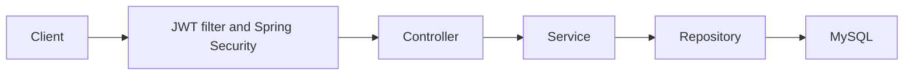

# SkillForge API

SkillForge is a Java and Spring Boot backend for a peer-to-peer skill exchange platform. Users publish skills, request exchanges with other users, progress an exchange through an authorized workflow, and rate a completed exchange.

## Features

- Email and password registration and login with BCrypt password hashing.
- Short-lived signed JWT access tokens and one-time rotating refresh tokens.
- User profile reads and updates, password changes, and logout/revocation.
- Skill creation, search, category/level filtering, pagination, update, and deletion.
- Server-side skill ownership enforcement with an admin override for skill edits/deletes.
- Exchange request, accept, reject, cancel, and complete transitions.
- Participant-only exchange details and ratings; one rating per participant per completed exchange.
- Database-backed notifications for exchange status changes and received ratings.
- Jakarta validation, structured API errors, Flyway schema bootstrap, Actuator health/info, Docker Compose, and GitHub Actions CI.

## Architecture



Controllers bind and validate HTTP requests. Services enforce ownership, state transitions, and transaction boundaries. Repositories use Spring Data JPA. API responses use DTOs rather than serializing entities.

## Authentication

`POST /api/v1/auth/login` checks the BCrypt hash and returns an access JWT and refresh token. The access token is signed using `JWT_SECRET`, contains the user's email subject and role claim, and expires according to `JWT_EXPIRATION` (milliseconds). Protected requests use `Authorization: Bearer <access-token>`. The filter reloads the account and role from MySQL; malformed or expired tokens remain unauthenticated and protected routes return 401.

`POST /api/v1/auth/refresh` consumes the current refresh token and rotates it. The previous token is removed, so it cannot be reused. `POST /api/v1/auth/logout` revokes the submitted refresh token. Changing a password revokes the user's refresh token. Access tokens remain valid until their expiry.

## API overview

All application endpoints are under `/api/v1`. Swagger UI is available at `/swagger-ui/index.html` when the application is running. Actuator exposes `/actuator/health` publicly and keeps details hidden; `/actuator/info` requires authentication.

| Area | Endpoints |
| --- | --- |
| Authentication | `POST /auth/register`, `/auth/login`, `/auth/refresh`, `/auth/logout` |
| Current user | `GET /users/me`, `PUT /users/me`, `POST /users/me/change-password` |
| Admin users | `GET /users`, `PUT /users/{userId}`, `DELETE /users/{userId}` |
| Skills | `POST /skills`, `GET /skills`, `GET /skills/me`, `GET /skills/{skillId}`, `PUT /skills/{skillId}`, `DELETE /skills/{skillId}` |
| Skill discovery | `GET /skills/search?skillName=...`, `GET /skills/category/{category}`, `GET /skills/level/{level}` |
| Exchanges | `POST /exchanges`, `GET /exchanges/me`, `GET /exchanges/{id}`, `PATCH /exchanges/{id}/{accept\|reject\|cancel\|complete}` |
| Ratings | `POST /exchanges/{exchangeId}/ratings`, `GET /users/{userId}/ratings` |
| Notifications | `GET /notifications`, `PATCH /notifications/{id}/read` |

Exchange transitions are `PENDING -> ACCEPTED | REJECTED | CANCELLED` and `ACCEPTED -> COMPLETED`. The requester can cancel pending requests; only the skill owner can accept or reject; only exchange participants can complete or rate. Ratings are limited to scores 1–5.

## Validation and errors

Request DTOs use Jakarta validation. Validation failures return HTTP 400 with a structured error response. Authentication failures return 401, authorization failures return 403, missing resources return 404, duplicate data and invalid state transitions return 409, and unexpected errors return a generic 500 response without exception details.

## Local setup

Requirements: Java 21, Maven (or the included Maven wrapper), and MySQL 8.4. Create a local database and export these variables before starting the app:

| Variable | Required | Description |
| --- | --- | --- |
| `DB_URL` | Yes | JDBC URL, e.g. `jdbc:mysql://localhost:3306/skillforge_db` |
| `DB_USERNAME` | Yes | MySQL account |
| `DB_PASSWORD` | Yes | MySQL password |
| `JWT_SECRET` | Yes | Random signing key with at least 32 bytes |
| `JWT_EXPIRATION` | No | Access token lifetime in milliseconds; defaults to `3600000` |
| `SPRING_PROFILES_ACTIVE` | No | `dev` by default; use `prod` for schema validation and SQL logging off |

Copy `skillforge/.env.example` to `skillforge/.env` and fill in local values. Spring Boot and Docker Compose load that file when the working directory is `skillforge/`. Set `JWT_SECRET` to a random value with at least 32 bytes. To generate one in Windows PowerShell, run these lines (the instance-based API works in Windows PowerShell 5.1 too):

```powershell
$rng = [System.Security.Cryptography.RandomNumberGenerator]::Create()
$bytes = New-Object byte[] 32
$rng.GetBytes($bytes)
$key = [Convert]::ToBase64String($bytes)
$rng.Dispose()
$key
```

Copy the printed value into `JWT_SECRET` in your local `.env` file. Set `DB_PASSWORD` to your local MySQL password. Never commit `.env` or share its contents.

For IntelliJ, open **Run → Edit Configurations**, select `SkillForgeApplication`, and set its working directory to the `skillforge` folder. Copy `skillforge/.env.example` to `skillforge/.env`, fill in the local values, then reload the Maven project from IntelliJ's Maven tool window so the run classpath includes all declared dependencies. If you prefer IntelliJ environment variables, set `DB_URL`, `DB_USERNAME`, `DB_PASSWORD`, `JWT_SECRET`, and optionally `JWT_EXPIRATION` in that Run Configuration instead. The database `skillforge_db` must already exist in MySQL; Flyway creates its tables. The default `dev` profile allows Hibernate `update` for local development. The `prod` profile requires explicit connection settings and uses `validate`; Flyway creates the initial schema and the baseline migration uses `CREATE TABLE IF NOT EXISTS` to preserve existing tables. Review the existing schema and back up the database before applying it to a real deployment.

Start with Maven:

```powershell
cd skillforge
.\mvnw.cmd spring-boot:run
```

Run tests and package:

```powershell
.\mvnw.cmd clean test
.\mvnw.cmd clean package
```

Or run MySQL and the API with Docker Compose from `skillforge/` after placing `.env` there:

```powershell
docker compose up --build
```

The Compose database uses a named volume (`mysql-data`). Back up that volume before operational changes.

## Database design

The schema contains users, skills, refresh tokens, skill exchanges, ratings, and notifications. Foreign keys protect relationships. Useful indexes cover skill ownership/category/level, exchange participants, rated users, and notification timelines. Flyway V1 bootstraps the schema; existing populated schemas are baselined at version 0, and existing tables are left intact by the migration.

## CI/CD

GitHub Actions runs the Maven tests against a disposable MySQL service using a generated ephemeral JWT signing key, then packages the application with Java 21. It does not deploy or publish a Docker image.

## Security notes and limitations

- Secrets are read from the environment and are not included in source configuration.
- A database password and JWT signing key were present in repository history before this hardening. Rotate both immediately; removing current values does not erase old commits. Purge sensitive history if the repository was shared.
- The access JWT is stateless, so password changes and logout do not invalidate already issued access JWTs before expiration.
- CORS is not configured for a browser frontend; configure an explicit origin allowlist when the deployment origin is known. No rate limiter is enabled.
- CI and the Docker image require network access to download Maven dependencies and base images.
- The generated Flyway bootstrap has not been run against the existing local MySQL database. Compare the migration with that database's actual schema and back it up before production rollout.

## Future work

Add refresh-token hashing at rest, access-token revocation/versioning, rate limiting, health/metrics endpoints, explicit CORS configuration, database-backed integration tests in Testcontainers, and deployment automation after the target environment is selected.
